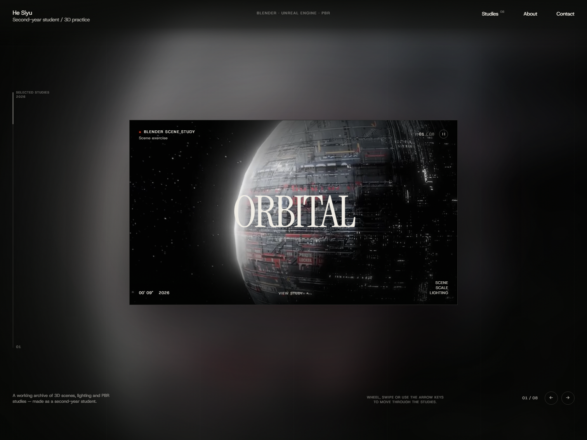
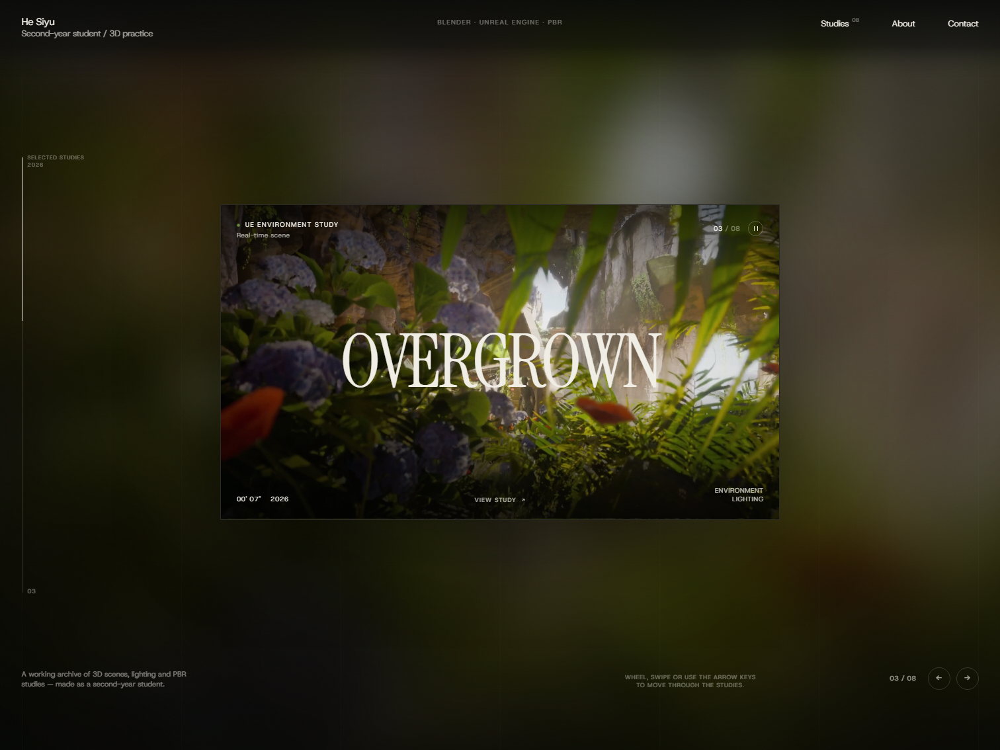
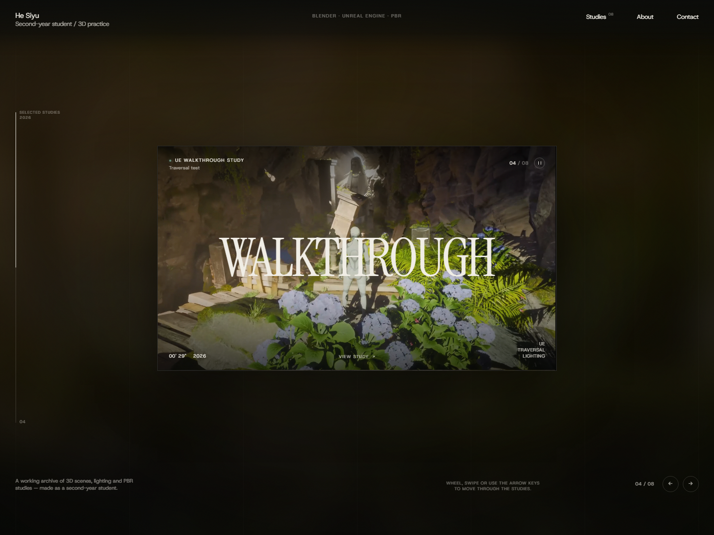
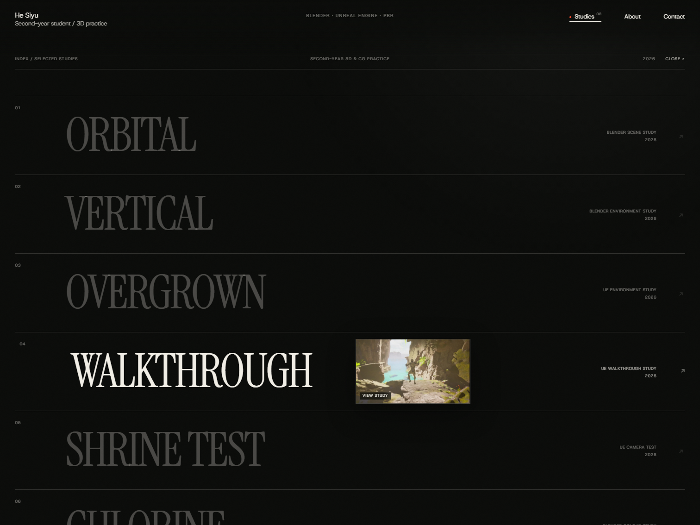
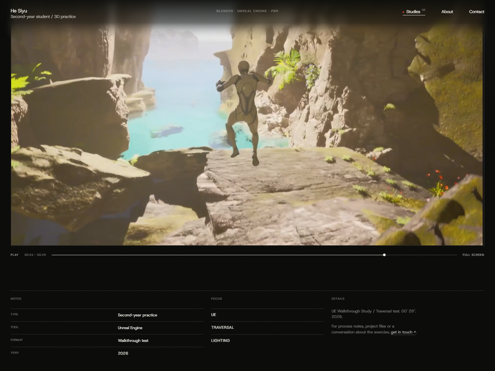
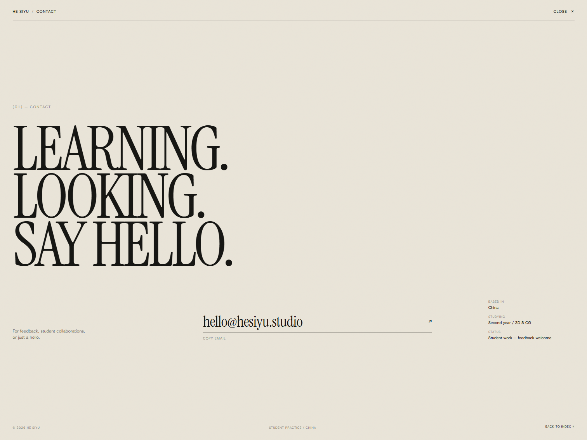

# 何思雨 — 3D Study Archive

一个以 [giordanobetti.com](https://giordanobetti.com/) 的排版与浏览方式为参考的**学生 3D 练习档案**。这里没有把自己包装成视频创作者或商业影像作者：所有条目都是大二阶段的课程 / 自学练习。

目前共 **8 个条目**：**3 个 Unreal Engine 练习、4 个 Blender 练习、1 个 PBR 练习**。

- 深色电影感视觉，Instrument Serif + Host Grotesk 字体组合
- 全屏「选中练习」舞台，滚轮 / 滑动 / 方向键切换
- 背景随练习切换为对应的**模糊循环影像**
- Studies 巨幅标题索引，悬停显示预览
- 练习详情页、Notes、Focus、视频播放器
- About 学生自述、米白色 Contact 覆盖页
- 开场加载动画、自定义光标、页面转场、移动端适配、减少动效偏好支持
- 纯静态 HTML / CSS / JS，无框架、无外部 CDN、无跟踪脚本

---

## 1. 立即预览

本地预览服务已经在运行：

**http://127.0.0.1:4173/**

如果服务停止，在项目目录中执行：

```bash
python serve.py
```

然后打开 http://127.0.0.1:4173/ 。Windows 下也可以双击 `start-preview.bat`。

`serve.py` 内置了 **HTTP Range** 支持，浏览器才能拖动 MP4 进度条。Python 自带的 `python -m http.server` 不支持 Range。部署到 Netlify / Vercel / Nginx 时这些平台默认支持 Range。

### 页面预览













---

## 2. 当前身份与需要补充的内容

现在网站按你说的定位写成：

| 内容 | 当前文案 |
| --- | --- |
| 姓名 | He Siyu / 何思雨 |
| 身份 | Second-year student / 3D practice |
| 方向 | Blender · Unreal Engine · PBR |
| 所在地 | China |
| 状态 | Student work — feedback welcome |
| 邮箱 | **hello@hesiyu.studio（占位，不是真实邮箱）** |
| 社交链接 | 空，自动隐藏 |

这些内容都可以在 **`assets/js/content.js`** 里统一修改：

- `profile.name` / `profile.nameCn` / `profile.shortRole`
- `profile.email` / `profile.socials` / `profile.location`
- `about` 下的自述、学习方向、状态
- 每个 study 的标题、类别、说明与 Notes

`hello@hesiyu.studio` 只是占位邮箱，记得换成真实邮箱。填写社交链接的示例：

```js
socials: [
  { label: "Instagram", url: "https://instagram.com/yourname" },
  { label: "Vimeo", url: "https://vimeo.com/yourname" }
]
```

---

## 3. 八个条目分别是什么

图片中的 3D 装置属于 **PBR 建模练习**。视频按制作工具划分：**Unreal Engine** 为 OVERGROWN、WALKTHROUGH、SHRINE TEST；**Blender** 为 ORBITAL、VERTICAL、CHLORINE、BLOOM STUDY。

| 页面标题 | 原始文件 | 工具 | 练习内容 |
| --- | --- | --- | --- |
| ORBITAL | `微信视频2026-11-24_125432_391.mp4` | Blender | 场景 / 缩略图循环 |
| VERTICAL | `微信视频2026-11-24_125423_896.mp4` | Blender | 环境 / 相机练习 |
| OVERGROWN | `11月24日 (2).mp4` | Unreal Engine | 环境 / 灯光练习 |
| WALKTHROUGH | `11月24日 (3).mp4` | Unreal Engine | 跑图测试 / 角色穿行 |
| SHRINE TEST | `0001-0120.mp4` | Unreal Engine | 神龛固定机位测试 |
| CHLORINE | `何思雨色彩作业.docx0000-1050.mp4` | Blender | 灯光 / 色彩练习 |
| BLOOM STUDY | `微信视频2026-11-24_125408_967.mp4` | Blender | 参考 / 过程记录 |
| THE DEVICE | 两张微信图片（3D 装置） | — | PBR 建模练习 |

原始文件没有移动或删除。每个视频条目另有 `assets/videos/backgrounds/*-bg.mp4`，是单独的低码率、预模糊循环，只用于首页背景；纯图片项目则使用模糊封面图。

### 清晰度与源文件限制

- WALKTHROUGH 来自 3404×2160 的 UE 源，输出为 1920×1080 高码率，并裁成 16:9 以适应舞台。
- SHRINE TEST 使用原始 H.264 视频 remux，没有再压缩。
- CHLORINE 同样使用原始 H.264 remux。
- OVERGROWN 来自 4K 源，输出为 1920×1080 高码率。
- BLOOM STUDY 原始文件是 HEVC，为了浏览器兼容性转成同分辨率 H.264 高码率。
- ORBITAL、VERTICAL 的源文件只有 **640×368**，网站内已放大到 1280×720 并轻度锐化，但无法恢复源文件里不存在的细节。如果你能找到更高分辨率的导出，可以直接替换对应文件。

### 加载体积

七部主视频合计约 88 MB（单部 4–33 MB），但页面一次只加载当前条目；首页模糊背景每部只有 0.2–0.9 MB。如果之后需要手机流量更友好的版本，可以再生成 720p 轻量版做响应式切换。

---

## 4. 修改 / 新增练习

练习数据在 `assets/js/content.js` 的 `projects` 数组里。复制一个对象并修改：

```js
{
  slug: "new-study",
  title: "NEW STUDY",
  titleLines: ["NEW", "STUDY"],
  category: "Blender Environment Study",
  context: "Scene exercise",
  year: "2026",
  duration: "00' 30\"",
  roles: ["Environment", "Lighting"],   // 显示为 Focus 标签
  video: "assets/videos/new-study.mp4", // 纯图片项目写 null
  backgroundVideo: "assets/videos/backgrounds/new-study-bg.mp4",
  poster: "assets/images/posters/new-study.jpg",
  accent: "#ff4d2e",
  fit: "cover",
  hasAudio: true,
  synopsis: "一句话说明这次练习。",
  description: ["第一段", "第二段"],
  notes: [
    { label: "Type", value: "Second-year practice" },
    { label: "Tool", value: "Blender" },
    { label: "Format", value: "Short scene" },
    { label: "Year", value: "2026" }
  ]
}
```

- `backgroundVideo` 可选；没有时会自动使用模糊海报。
- 纯图片项目：`video: null`，用 `stills` 列出图片，`fit` 可按构图选 `"cover"` 或 `"contain"`。
- 替换同名视频/海报时，直接覆盖 `assets/videos/`、`assets/videos/backgrounds/`、`assets/images/posters/` 中的文件即可。
- 推荐视频规格：MP4 (H.264)，16:9，1920×1080，5–8 Mbps；海报 1920×1080。

---

## 5. 交互说明

- **首页**：八个练习，滚轮 / 触屏滑动 / 方向键 / 左右按钮切换；点击画面进入详情；右上角暂停 / 播放舞台视频
- **Studies**：悬停高亮标题并浮出预览；点击打开练习
- **详情页**：视频自动静音播放，可播放 / 暂停、拖动进度、开关声音、全屏；下方有 Notes 与 Focus
- **About**：学生自述、学习方向、信息与 PBR 练习图
- **Contact**：米白色覆盖页，欢迎反馈、学生合作或简单问候；点击邮箱发信，也可以复制邮箱
- **键盘**：方向键切换首页练习，Esc 逐层退出；Contact 内 Tab 焦点被限制在弹层中
- **reduce motion**：开启「减少动态效果」后不会自动播放视频，并大幅缩短转场

---

## 6. 文件结构

```
hesiyu-portfolio/
├─ index.html                 # 页面骨架
├─ assets/
│  ├─ css/site.css            # 所有样式、响应式、动效
│  ├─ js/content.js           # ★ 所有练习与个人信息
│  ├─ js/site.js              # 路由、轮播、播放器、光标等交互
│  ├─ fonts/                  # 本地字体
│  ├─ images/
│  │  ├─ posters/             # 首页 / 列表 / 视频封面
│  │  └─ stills/              # PBR 练习图
│  ├─ videos/                 # 网页用的高清 MP4
│  │  └─ backgrounds/         # 首页模糊循环背景
│  └─ favicon.svg
├─ preview/                   # 页面预览截图
├─ serve.py                   # 支持 Range 的本地预览服务
├─ start-preview.bat          # Windows 一键预览
└─ README.md
```

---

## 7. 发布

这是一个纯静态站点，上传整个 `hesiyu-portfolio` 文件夹即可：

- **Netlify Drop**：打开 https://app.netlify.com/drop，把文件夹拖进去
- **Vercel**：Framework 选 Other，Build Command 留空
- **GitHub Pages**：将文件推到仓库根目录并开启 Pages
- **自己的服务器**：确保 MP4 响应带 `Accept-Ranges: bytes`；Nginx / Apache 默认支持

发布前记得替换邮箱、社交链接，并检查所有练习说明。

---

## 8. 设计备注

视觉基础来自参考站点的编辑式排版：大号衬线标题、极简信息层、深色全屏舞台、以作品为中心的单屏浏览。颜色与组件没有照搬，而是结合练习内容加入了：

- 随练习切换的模糊视频背景与环境色
- 更克制的学生档案语气：Studies / Notes / Focus，而不是商业 Credits
- 用两张 PBR 图片构成的 THE DEVICE 纯图像条目
- 自定义播放器、加载动画与完整的移动端布局

字体：Instrument Serif / Host Grotesk（本地 woff2）。上线前请再次确认字体许可；两者均为开源字体，可自行核对授权。
